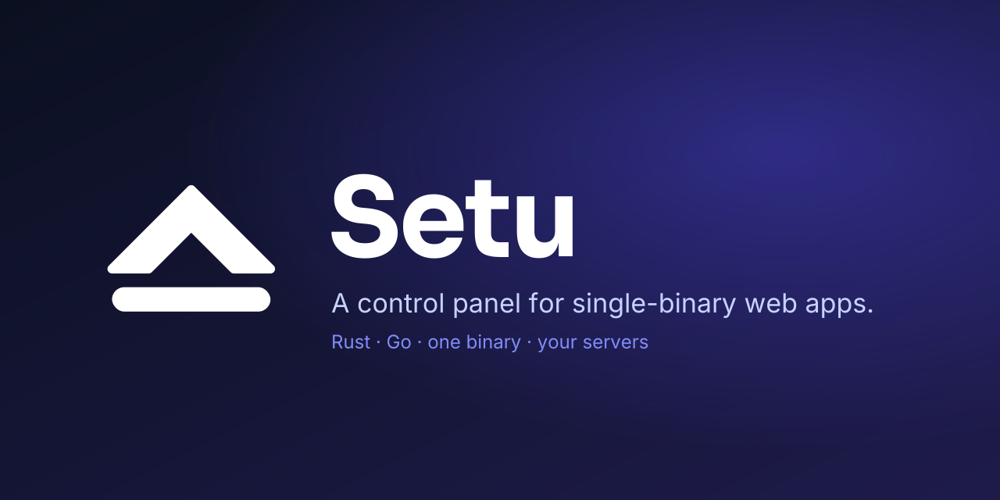

# Setu

A control panel for single-binary web apps: pick an app, get a domain,
a database, TLS, backups, updates and resource limits on servers you
own. Working name; see `docs/specs/2026-10-09-setu-design.md`.

Status: 0.1.0 released; the panel runs on real servers. Phase 2 is planned in `docs/ROADMAP.md`.
final review and the merge. Gates on the branch: `cargo fmt --check`,
`cargo clippy --workspace --all-targets -- -D warnings`,
`scripts/test.sh`, the UI checks (`pnpm -C ui lint|typecheck|test`),
`scripts/e2e.sh` (14 assertions, `E2E PASS`),
`scripts/test-install.sh` (9 assertions, `INSTALL PASS`) and
`scripts/check-links.sh`.

Documentation: `docs/README.md` (install, operations, manifests,
agents, security). Roadmap for later phases: `docs/ROADMAP.md`.
Contributors and agent sessions start with `the private planning repository`.
